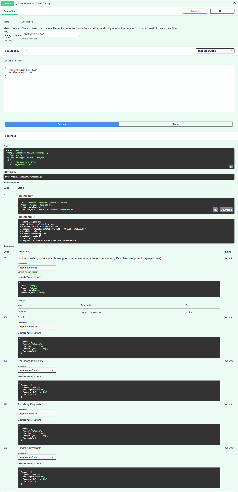
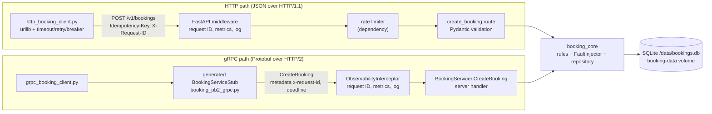
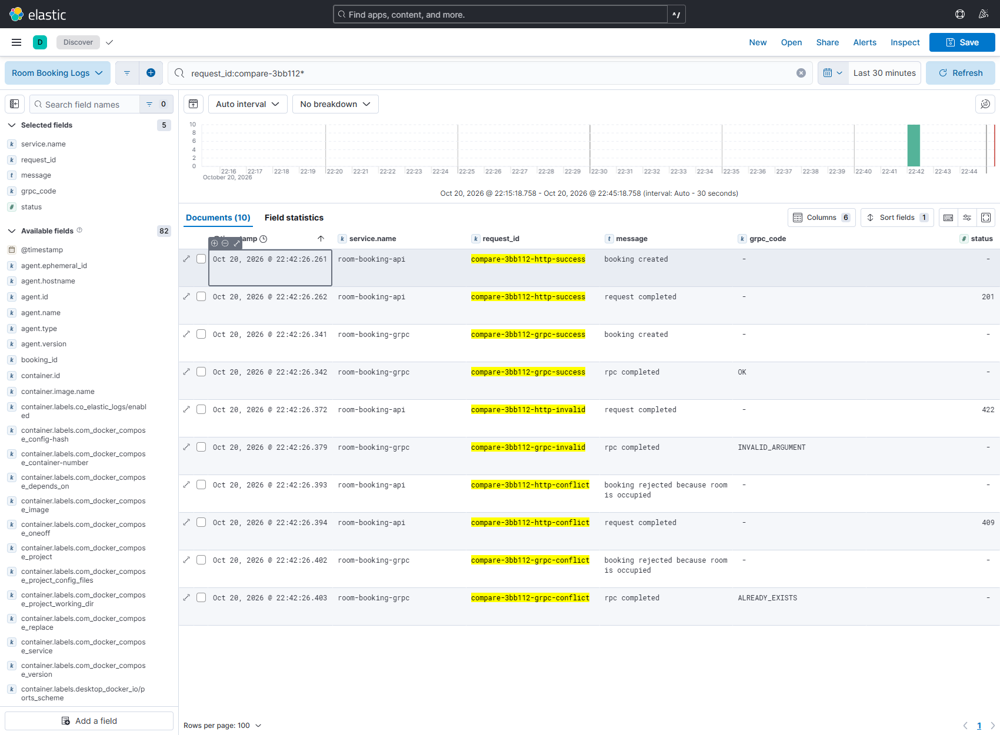
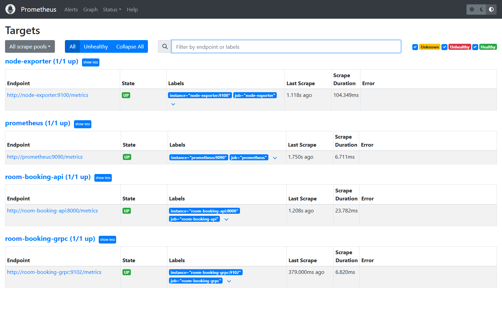
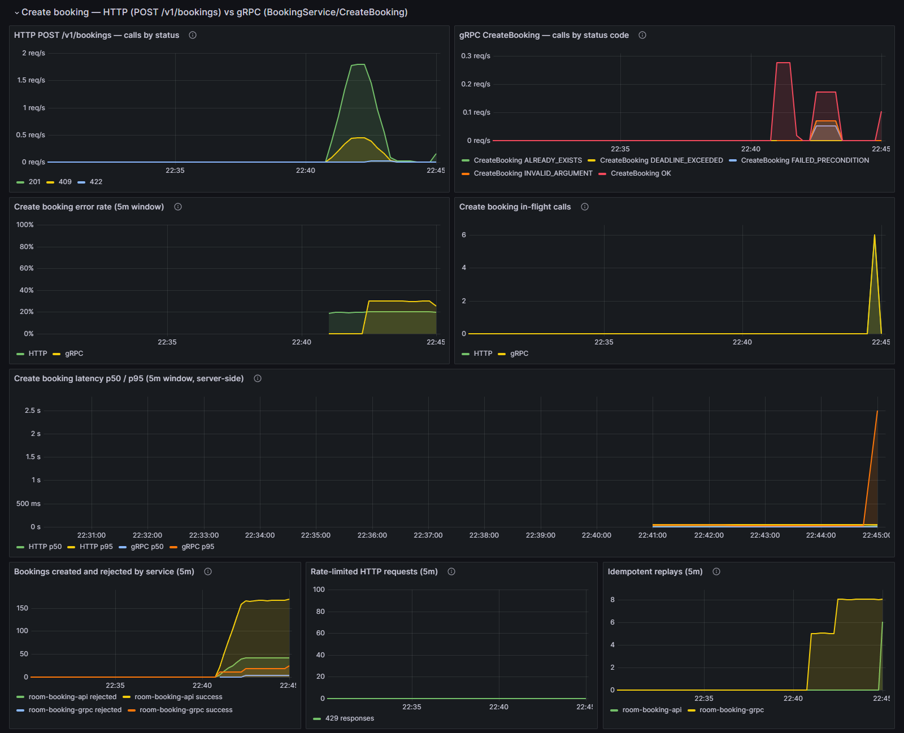

# Assignment 2: HTTP APIs, gRPC, and Metrics

Campus Room Booking, extended from Assignment 1. Measurements were taken from
the local Compose stack on 20 October 2026. Times in the output files are
Asia/Karachi local time (UTC+05:00); log timestamps are UTC.

**Chosen user task:** *Book a study room* (create a booking). It is improved
over HTTP in Part A and implemented again as a gRPC service in Part B.

---

## Part A — HTTP API

### A.1 REST constraints

| Constraint | Plain-language meaning | In this API |
|---|---|---|
| Client–server | The client handles the user side and the server owns the data and rules. Each can change independently. | The Python callers, Swagger UI, and the experiment scripts are clients. The FastAPI service owns the rules (`booking_core`) and the database. Clients only know URLs and JSON. |
| Stateless | Each request carries everything needed to handle it; the server keeps no per-client session between requests. | There is no login or session. Each `POST /v1/bookings` carries its body, its optional `Idempotency-Key`, and an `X-Request-ID`. The rate-limit counter is server state, but it never changes what a request *means*. |
| Cacheable | Responses say whether a client or proxy may reuse them. | **Not demonstrated.** `GET /v1/bookings/{id}` could be cached, but the API sends no `Cache-Control` or `ETag` headers, because bookings can be cancelled at any time. |
| Uniform interface | Resources have URLs, standard methods act on them, and messages describe themselves. | `/v1/bookings` (collection) and `/v1/bookings/{id}` (item) use GET/POST/DELETE with standard status codes. `201` returns a `Location` link to the new booking. Every error has the same JSON shape. Full hypermedia (HATEOAS) is not implemented beyond `Location`. |
| Layered system | A client cannot tell whether it talks to the server directly or through intermediaries such as proxies or gateways. | **Partly.** Docker's port publishing already sits between host clients and the container. No gateway is implemented, but one could be added without changing the clients. A side effect is that the rate limiter sees the Docker gateway address, not each host client (A.5). |
| Code on demand *(optional)* | The server may send code for the client to run. | Only Swagger UI at `/docs` does this: it sends JavaScript to the browser. The JSON API itself does not. |

### A.2 Endpoint review: before and after

**Before/after for the chosen task (create a booking):**

| Old endpoint | Problem | Change | Reason |
|---|---|---|---|
| `POST /bookings` | A retry after a timeout could create a second booking, or return a confusing `409` for the caller's own booking | Optional `Idempotency-Key` header. A repeat with the same key and body returns the stored booking (`201`, `Idempotent-Replayed: true`). The same key with a different body returns `422 idempotency_key_reused` | Callers can retry safely (A.4) |
| | Errors had different shapes: `{"detail": "..."}` for 404/409, and FastAPI's list format for 422 | One `ErrorResponse` format: `code`, `message`, `request_id`, `details` | Callers can handle every error the same way. `request_id` links the error to the logs |
| | No link to the new booking, and no way to fetch one booking | `201` + `Location: /v1/bookings/{id}`, and a new `GET /v1/bookings/{id}` | Uniform interface |
| | Unknown JSON fields were silently ignored; a room of only spaces was accepted | `extra="forbid"`; the shared rules trim the room name before checking its length | Input validation |
| | No protection against bursts | 30 requests per 10 s per client, then `429` + `Retry-After` | Rate limiting (A.5) |
| | Bookings lived in one process's memory | Shared SQLite database through `booking_core` | Needed so gRPC can share the source of truth (Part B) |
| | No version in the path | `/v1/...` | Lets the API change later without breaking callers |

**Other endpoints:**

| Endpoint | Decision |
|---|---|
| `GET /bookings` → `GET /v1/bookings` | Path version only |
| *(new)* `GET /v1/bookings/{id}` | Added: 200, or 404 in the error format |
| `DELETE /bookings/{id}` → `DELETE /v1/bookings/{id}` | Now `204 No Content` instead of `200` with a body. A repeat returns `404` (A.4) |
| `POST /fault/slow?enabled=` → `PUT /v1/admin/faults/create-booking` | A JSON body `{delay_ms, every_nth, fail_next, fail_always}` replaces the whole configuration, so PUT fits. It is stored in the database so it affects HTTP and gRPC alike. `fail_next` makes failures repeatable for the caller test |
| `POST /demo/cardinality` | Left alone: A1 experiment only. It now uses the error format |
| `/health`, `/metrics` | Excluded, as the brief allows |

**Callers updated:** `experiments/load_test.py` and
`experiments/anomaly_experiment.py` now use the new paths and the fault
endpoint (A1 delay = `{"delay_ms": 500, "every_nth": 5}`). The Grafana panels
now filter on `route="/v1/bookings"`.

**Tests** in `tests/test_http_api.py`, `python -m pytest`, 38 passed in total:

| Case | Result |
|---|---|
| Valid request | `201`, `Location` resolves with GET to the same booking |
| Invalid input (`room=""`, `duration_minutes=5`, extra field) | `422 validation_error` with one detail per field |
| Repeated request, same `Idempotency-Key` | Second response is `201`, same booking, `Idempotent-Replayed: true`; only one booking stored |
| Repeated request without a key | `409 room_occupied` |
| DELETE twice | `204`, then `404 booking_not_found` |

### A.3 OpenAPI

The OpenAPI Specification is a standard, language-neutral way to describe an
HTTP API in YAML or JSON: its paths, methods, parameters, request bodies,
responses, and data schemas. Tools read it to generate documentation (Swagger
UI), client code, mock servers, and contract tests, so the description is the
shared contract between the API's owners and its callers.

- **The spec:** [`openapi/openapi.yaml`](openapi/openapi.yaml), OpenAPI 3.1.0.
  - It is exported from the FastAPI app by `scripts/export_openapi.py`.
  - Routes declare their error responses, so each error status points to the `ErrorResponse` schema. The `Idempotency-Key` header and the `Location` header are documented.
  - `tests/test_openapi.py` fails if the committed file no longer matches the app.
- **Validation:** `openapi-spec-validator openapi/openapi.yaml` gives `OK` (`evidence/a2/openapi-validation.txt`).
- **Testing with it:** `python -m clients.openapi_contract_check` reads `openapi.yaml`, builds a request from the spec's `examples`, sends live requests, and checks each response against the schema the spec documents:

```text
PASS valid booking: HTTP 201 documented; body matches #/components/schemas/Booking
PASS same room again: HTTP 409 documented; body matches #/components/schemas/ErrorResponse
PASS invalid input: HTTP 422 documented; body matches #/components/schemas/ErrorResponse
PASS unknown booking: HTTP 404 documented; body matches #/components/schemas/ErrorResponse
4/4 checks passed
```

- **Inspection:** the same document drives Swagger UI at <http://localhost:8000/docs>. Using "Try it out" on `POST /v1/bookings` returned `201` with the `location` and `ratelimit-*` headers, and the spec lists each documented error response:



### A.4 Idempotency (safe repeats)

- **`POST /v1/bookings`** is not naturally idempotent, so it is *protected*.
  - **Recording a key:** the caller sends an `Idempotency-Key` and reuses it on every retry. The key, a SHA-256 hash of the cleaned body, and the stored booking are written in the **same SQLite transaction** as the booking. Either both are saved or neither is.
  - **A repeat:** a repeat with the same key and body returns the original booking and stores nothing.
  - **Misuse:** the same key with a different body is rejected with `422`.
  - **Expiry:** keys expire after 24 hours.
  - **Across transports:** the gRPC `idempotency_key` field uses the same table, so a key is honoured on either transport.
- **`DELETE /v1/bookings/{id}`** is idempotent in effect. After one or many deletes, the booking is gone. The repeat returns `404` because the resource no longer exists, but nothing else changes, so retrying is safe.
- **`PUT /v1/admin/faults/create-booking`** replaces the whole configuration, so sending it twice leaves the same state.
- **GET** requests change nothing.

### A.5 Rate limiting

| | |
|---|---|
| Endpoint | `POST /v1/bookings` only |
| Limit | **30 requests per 10-second window** (`app/rate_limit.py`, in memory, one instance) |
| Who shares it | All requests from the same client IP address. Host clients reach the container through Docker Desktop's port publishing, so they normally appear as one gateway address and share one limit. |
| When calls are allowed again | The window starts at the client's first counted request. When it ends the count resets. `Retry-After` gives the seconds left, rounded up. |
| Headers | `RateLimit-Limit`, `RateLimit-Remaining`, `RateLimit-Reset` on accepted requests; `429` adds `Retry-After` |

Result (`python -m clients.rate_limit_demo`, `evidence/a2/rate-limit-demo.txt`):

```text
[16:05:03.642] request  1: 201 Created   RateLimit-Remaining=29 (limit 30)
...
[16:05:04.483] request 30: 201 Created   RateLimit-Remaining=0 (limit 30)
[16:05:04.494] request 31: 429 Too Many Requests  Retry-After=10  body=Limit of 30 requests per 10 seconds reached; retry after 10 seconds
[16:05:04.504] request 32: 429 Too Many Requests  Retry-After=10  ...
[16:05:04.516] request 33: 429 Too Many Requests  Retry-After=10  ...
[16:05:04.516] waiting Retry-After = 10s ...
[16:05:14.548] after waiting: HTTP 201  RateLimit-Remaining=29
```

**Limitations:**
- A fixed window can let up to 60 requests through in a short burst that straddles a window boundary.
- The counters reset when the service restarts.
- Several API replicas would each enforce their own limit. A shared store such as Redis would fix this.

### A.6 Python caller: timeout, retry, circuit breaker

`clients/http_booking_client.py` calls `POST /v1/bookings` the way another
service would. Settings:

| Setting | Value |
|---|---|
| Timeout | 1.0 s per attempt |
| Retry | At most 3 attempts per call. Backoff is 0.25 s, then 0.5 s, plus up to 0.1 s of random jitter |
| What is retried | Timeouts, connection errors, `502/503/504`. `429` waits for `Retry-After`. Other `4xx` are never retried |
| Why retrying is safe | Every call sends one `Idempotency-Key`, reused by all its attempts (A.4) |
| Circuit breaker | Opens after **3 consecutive failed attempts**, refuses calls for **5 s**, then lets **one** half-open trial through. Success closes it; failure reopens it |

Output (`python -m clients.http_booking_client --demo`, `evidence/a2/http-client-demo.txt`):

```text
== 1. Normal operation ==
call-1 attempt 1/3 [CLOSED]: HTTP 201 booking f460c6c9 room=Caller-e5647d-1 -> breaker CLOSED
call-2 attempt 1/3 [CLOSED]: HTTP 201 booking 0d89e810 room=Caller-e5647d-2 -> breaker CLOSED
== 2. Transient failure: the next request fails once with 503 ==
call-3 attempt 1/3 [CLOSED]: HTTP 503 injected_fault -> failures=1, retrying in 0.33s
call-3 attempt 2/3 [CLOSED]: HTTP 201 booking c26e66c4 room=Caller-e5647d-3 -> breaker CLOSED
== 3. Outage: every request is slow (2 s) and then fails ==
call-4 attempt 1/3 [CLOSED]: timed out after 1s -> failures=1, retrying in 0.30s
call-4 attempt 2/3 [CLOSED]: timed out after 1s -> failures=2, retrying in 0.50s
call-4 attempt 3/3 [CLOSED]: timed out after 1s -> failures=3, breaker OPEN
call-5 attempt 1/3: BLOCKED by breaker (circuit open; next trial in 5.0s); server not contacted
call-6 attempt 1/3: BLOCKED by breaker (circuit open; next trial in 5.0s); server not contacted
== 4. Recovery: fault removed; wait for the breaker's recovery period ==
breaker is now HALF_OPEN
call-7 attempt 1/3 [HALF_OPEN]: HTTP 201 booking f9c7bf94 room=Caller-e5647d-7 -> breaker CLOSED
call-8 attempt 1/3 [CLOSED]: HTTP 201 booking 00fb2a2f room=Caller-e5647d-8 -> breaker CLOSED
```

**What this shows:**
- **Stage 2:** a single server failure is hidden from the caller by one retry.
- **Stage 3:** the timeout bounds each wait to 1 s. After three failures the breaker stops sending requests, so calls 5 and 6 fail immediately instead of adding load to a struggling server.
- **Stage 4:** after 5 s, one trial request finds the server healthy and normal traffic resumes.

---

## Part B — gRPC service

### B.1 Contract, generation, handler

- **Contract:** [`booking_proto/booking.proto`](booking_proto/booking.proto), package `roombooking.v1`:

```protobuf
service BookingService {
  rpc CreateBooking(CreateBookingRequest) returns (CreateBookingResponse);
}
message CreateBookingRequest { string room = 1; int32 duration_minutes = 2; string idempotency_key = 3; }
message Booking { string id = 1; string room = 2; int32 duration_minutes = 3; string created_at = 4; }
message CreateBookingResponse { Booking booking = 1; bool replayed = 2; }
```

- **Generation command** (`scripts/generate_proto.ps1` / `.sh`; the Dockerfile runs it too):

```text
python -m grpc_tools.protoc -I . --python_out=. --grpc_python_out=. --pyi_out=. booking_proto/booking.proto
```

  It produces `booking_pb2.py` (the message classes) and `booking_pb2_grpc.py` (`BookingServiceStub` for clients, and `BookingServiceServicer` with `add_BookingServiceServicer_to_server` for the server).

- **Handler:** `BookingServicer.CreateBooking` in `grpc_service/server.py` runs in a separate container, `room-booking-grpc`, built from the same image with a different command.
  - It calls `booking_core.repository.create_booking`, the same function `POST /v1/bookings` calls, on the same SQLite file on the shared `booking-data` volume.
  - There is no HTTP call: the gRPC service would work even if the HTTP API were stopped.
- **One set of rules:**
  - Validation, case-insensitive room uniqueness, and idempotency live in `booking_core` and are shared by both transports.
  - The `UNIQUE(room_key)` column and `BEGIN IMMEDIATE` transactions keep the rule correct when both processes write at the same time.

### B.2 Client

`clients/grpc_booking_client.py` uses the generated stub directly. It takes
`--room`, `--duration`, `--idempotency-key`, `--request-id`, and
`--deadline` (default 2 s). It prints the booking, or the gRPC status code and
details.

### B.3 Success and failure through both versions

From `python -m clients.compare_transports` (`evidence/a2/transport-comparison.txt`), bodies shortened:

| Case | HTTP | gRPC |
|---|---|---|
| Success | `201` `{"id": "f84f88df…", "room": "Compare-2fb21e-HTTP", …}` | `OK booking=7e8d2825… room=Compare-2fb21e-gRPC` |
| Invalid duration (5) | `422` `{"error": {"code": "validation_error", "details": [{"field": "duration_minutes", …}]}}` | `INVALID_ARGUMENT: Booking request is invalid (duration_minutes: must be between 15 and 180 minutes)` |
| Room booked through the *other* transport | `409` `{"error": {"code": "room_occupied", …}}` for the room gRPC booked | `ALREADY_EXISTS` for the room HTTP booked |

The last row shows that both transports share one source of truth.

**How the statuses map:**

| Situation | HTTP status | gRPC status | Why |
|---|---|---|---|
| Created | `201 Created` | `OK` | gRPC has a single success code; the response message carries the result |
| Invalid input | `422 Unprocessable Content` | `INVALID_ARGUMENT` | The request is malformed whatever the server's state; don't retry unchanged |
| Room taken | `409 Conflict` | `ALREADY_EXISTS` | The entity the client tried to create already exists |
| Key reused with a different body | `422` | `FAILED_PRECONDITION` | The request conflicts with stored state for that key |
| Injected server fault | `503` + `Retry-After` | `UNAVAILABLE` | Temporary; safe to retry with the same idempotency key |
| Caller stops waiting | client timeout (no response) | `DEADLINE_EXCEEDED` | gRPC carries the deadline to the server (B.5) |
| Too many requests | `429` + `Retry-After` | — | The rate limit applies to HTTP only |

A gRPC call is still an HTTP/2 exchange. The HTTP/2 response status is normally `200` even when the call fails, and the real outcome is in the `grpc-status` trailer. That is why gRPC errors can't be read from HTTP status codes.

### B.4 Call paths



### B.5 Logs and correlation across the gRPC boundary

- **Same log format:** the gRPC service writes the A1 JSON log format through the shared `booking_core.telemetry.write_log`. The service is `service.name="room-booking-grpc"`, and there are new fields `rpc.method`, `grpc_code`, and `duration_ms`.
- **Collection:** Filebeat collects these logs through the container label `co.elastic.logs/enabled`, with no configuration changes.
- **Correlation:**
  - The client sends `x-request-id` in gRPC metadata.
  - The interceptor reads it (or generates one), keeps it in a context variable for the handler's logs, and echoes it back in the response metadata.
  - HTTP keeps the A1 `X-Request-ID` header.

Elasticsearch query for one comparison run (`request_id` prefix
`compare-2fb21e`); in Kibana: `request_id:compare-2fb21e*`:

```text
room-booking-api   compare-2fb21e-http-success    booking created
room-booking-api   compare-2fb21e-http-success    request completed 201
room-booking-grpc  compare-2fb21e-grpc-success    booking created
room-booking-grpc  compare-2fb21e-grpc-success    rpc completed OK
room-booking-api   compare-2fb21e-http-invalid    request completed 422
room-booking-grpc  compare-2fb21e-grpc-invalid    rpc completed INVALID_ARGUMENT
room-booking-api   compare-2fb21e-http-conflict   booking rejected because room is occupied
room-booking-api   compare-2fb21e-http-conflict   request completed 409
room-booking-grpc  compare-2fb21e-grpc-conflict   booking rejected because room is occupied
room-booking-grpc  compare-2fb21e-grpc-conflict   rpc completed ALREADY_EXISTS
```

The same search in Kibana Discover (`request_id:compare-3bb112*`) shows HTTP and gRPC logs side by side, each carrying the request ID its client sent:



**Deadline finding:**
- **The problem:** with a 1.5 s delay injected and a 1 s client deadline, the first version of the handler kept working after the client had given up. It stored the booking and recorded `OK`, while the client saw `DEADLINE_EXCEEDED`.
- **The fix:** the handler now checks `context.is_active()` before writing. Abandoned calls are not stored; they are logged as `deadline passed before the booking was stored` and counted as `DEADLINE_EXCEEDED` (`evidence/a2/grpc-deadline-demo.txt`).
- **What remains:** a deadline can still expire during the few milliseconds of the database write. That window is covered by retrying with the same idempotency key.

---

## Part C — Metrics

### C.1 Audit of A1 metrics

| A1 metric / area | Useful? | Gap | Action in A2 |
|---|---|---|---|
| `room_booking_http_requests_total{method,route,status}` | Yes: rate and error rate | The `route` label fell back to the raw URL for unknown paths, so every random 404 path created a new series (unbounded) | Fixed: unknown paths are labelled `route="unmatched"` (tested) |
| `room_booking_http_request_duration_seconds` | Yes: p95 | Lowest bucket was 10 ms while typical requests take ~12 ms, so p50 was a guess. Buckets differed from anything gRPC would use | Shared `LATENCY_BUCKETS` `[1ms … 2.5s]` for HTTP and gRPC |
| `room_booking_active_bookings` (gauge `inc`/`dec`) | Yes | Counted only bookings made by its own process; wrong once gRPC also creates bookings, and reset on restart | Now `set_function(repository.count_active)`: read from the shared database at scrape time |
| `room_booking_events_total{action,result}` | Yes: business outcomes | No way to tell which transport | Also exported by the gRPC process; the `job` label separates them (no new label) |
| `room_booking_validation_duration_seconds` (Summary) | Low | Only an average; now measures the rule check plus the insert transaction | Kept (A1 panel); not extended |
| *(missing)* gRPC calls, errors, latency | — | No metrics for the new service | Added (C.2) |
| *(missing)* concurrency | — | No view of calls waiting during slow periods | In-flight gauges for HTTP and gRPC |
| *(missing)* rate limiter and idempotency | — | 429s and replays were invisible to Prometheus | `room_booking_rate_limited_total`, `room_booking_idempotent_replays_total` |

### C.2 New and changed metrics

All labels are bounded: method names come from the `.proto`, codes from the
fixed gRPC/HTTP sets, and routes from route templates. No user, booking,
request, or trace IDs are used as labels; those stay in the logs. **Duration is
measured on the server**: in the gRPC interceptor and in the HTTP middleware.
The Python callers have no Prometheus endpoint.

| Metric | Purpose | Type | Unit | Labels | Code location | Query (Grafana) |
|---|---|---|---|---|---|---|
| `room_booking_grpc_server_handled_total` | Calls and errors per RPC | Counter | calls | `grpc_service`, `grpc_method`, `grpc_code` | `grpc_service/interceptors.py`, `finally` of `observed()` | `sum by (grpc_method, grpc_code) (rate(room_booking_grpc_server_handled_total{grpc_method="CreateBooking"}[1m]))` |
| (same) | Error rate | — | % | — | — | `100 * (sum(rate(room_booking_grpc_server_handled_total{grpc_method="CreateBooking",grpc_code!="OK"}[5m])) or vector(0)) / sum(rate(room_booking_grpc_server_handled_total{grpc_method="CreateBooking"}[5m]))` |
| `room_booking_grpc_server_handling_seconds` | Latency distribution, p50/p95 | Histogram | seconds | `grpc_service`, `grpc_method`, `le` | interceptor, `perf_counter` around the handler | `histogram_quantile(0.95, sum by (le) (rate(room_booking_grpc_server_handling_seconds_bucket{grpc_method="CreateBooking"}[5m])))` (and `0.50`) |
| `room_booking_grpc_server_in_flight` | RPCs being handled right now | Gauge | calls | `grpc_service`, `grpc_method` | interceptor, `inc()` before / `dec()` after the handler | `sum(room_booking_grpc_server_in_flight{grpc_method="CreateBooking"}) or vector(0)` |
| `room_booking_http_in_flight_requests` | The same for HTTP, for side-by-side | Gauge | requests | `method`, `route` | `app/main.py` `observe_request` middleware | `sum(room_booking_http_in_flight_requests{route="/v1/bookings",method="POST"}) or vector(0)` |
| `room_booking_rate_limited_total` | How often callers hit the limit | Counter | requests | `route` | `app/main.py` `enforce_create_rate_limit` | `sum(increase(room_booking_rate_limited_total[5m])) or vector(0)` |
| `room_booking_idempotent_replays_total` | Retries that would have duplicated a booking | Counter | requests | none (`job` added by Prometheus) | `app/main.py` `create_booking`, `grpc_service/server.py` `CreateBooking` | `sum by (job) (increase(room_booking_idempotent_replays_total[5m]))` |
| `room_booking_http_request_duration_seconds` *(changed buckets)* | HTTP p50/p95 next to gRPC | Histogram | seconds | `method`, `route`, `le` | `app/main.py` middleware | `histogram_quantile(0.95, sum by (le) (rate(room_booking_http_request_duration_seconds_bucket{route="/v1/bookings",method="POST"}[5m])))` |
| `room_booking_events_total` *(now in both processes)* | Bookings created and rejected per service | Counter | events | `action`, `result` (+ `job`) | both create handlers | `sum by (job, result) (increase(room_booking_events_total{action="create"}[5m]))` |

**Time windows:**
- Rates use `[1m]` so call panels react quickly.
- Error rate and p50/p95 use `[5m]`: each point summarises the calls of the previous five minutes. A latency spike therefore fades out over five minutes rather than disappearing immediately.
- p50/p95 are estimated from bucket boundaries and are not exact sorted percentiles.

**Why in-flight and not message size:**
- `CreateBooking` messages are tiny and almost fixed in size: two short strings and an int. A size histogram would be nearly flat and would say little.
- In-flight calls show concurrency and saturation. During the deadline demo, four slow calls overlapped and the gauge read 4:

```text
room_booking_grpc_server_in_flight{grpc_method="CreateBooking",grpc_service="roombooking.v1.BookingService"} 4.0
```

**Other missing metrics:** `room_booking_rate_limited_total` and
`room_booking_idempotent_replays_total` make the two Part A practices
observable. Without them, a caller being throttled or retrying heavily would
not show up on any panel.

### C.3 Prometheus and Grafana

- `monitoring/prometheus/prometheus.yml` adds the job `room-booking-grpc` → `room-booking-grpc:9102`. The gRPC process serves `/metrics` there with `prometheus_client.start_http_server`.
- `/targets` shows four targets UP: `room-booking-api`, `room-booking-grpc`, `node-exporter`, `prometheus`.
- The dashboard has a new row, **Create booking — HTTP vs gRPC**:
  - HTTP calls by status | gRPC calls by code
  - Error rate, HTTP and gRPC lines (5 m) | In-flight, HTTP and gRPC lines
  - Latency p50/p95, four lines: HTTP and gRPC (5 m)
  - Bookings created/rejected by service | Rate-limited | Idempotent replays

**Repeatable traffic to fill the panels:**

```powershell
python -m clients.grpc_booking_client --demo --rounds 3   # per round: 3 OK (one replayed), ALREADY_EXISTS, INVALID_ARGUMENT, FAILED_PRECONDITION
python -m clients.compare_transports                      # same cases over HTTP and gRPC
python experiments\load_test.py --duration 120            # HTTP mix: 201, 409, 204, 200
python -m clients.rate_limit_demo                         # 429s
```

**Values measured after these runs:**
- HTTP p50 ≈ 17.7 ms and p95 ≈ 46.8 ms.
- gRPC p50 ≈ 13.2 ms. gRPC p95 was 2.2 s, raised by the deadline demo's 1.5 s injected delays inside the 5-minute window.
- gRPC codes seen: `OK`, `ALREADY_EXISTS`, `INVALID_ARGUMENT`, `FAILED_PRECONDITION`, `DEADLINE_EXCEEDED`.

**In-flight test:** just before the dashboard capture, a 4 s delay was injected and six gRPC calls (8 s deadline) were sent at the same time. Prometheus recorded `max_over_time(sum(room_booking_grpc_server_in_flight)[2m:2s]) = 6`. The same slow calls cause the gRPC p95 spike at the right of the latency panel. Afterwards the fault was removed.

**Dashboard evidence:**





The full dashboard, including the A1 panels, is in `evidence/a2/grafana-full-dashboard.png`.

---

## Known limitations and things not yet understood

- **SQLite:** it suits one host with two processes. Multiple machines would need a database server such as PostgreSQL.
- **Rate limiter:** it is per instance and in memory (A.5).
- **Idempotency keys:** there are no user accounts, so keys share one global namespace. A real API would scope them per client.
- **Correlation:** it uses the A1 request ID. Full distributed tracing with W3C `traceparent` and spans (e.g. OpenTelemetry) is not implemented.
- **Breaker cutoff:** the circuit breaker counts attempts, not calls. Choosing the threshold well for real traffic needs more study.

## References and assistance

- gRPC documentation: core concepts, deadlines, status codes, Python interceptors (grpc.io); Protocol Buffers language guide (protobuf.dev).
- OpenAPI Specification 3.1 (spec.openapis.org); FastAPI documentation on error handling and OpenAPI.
- RFC 9110 (HTTP semantics), RFC 6585 (`429 Too Many Requests`); IETF HTTPAPI drafts for the `Idempotency-Key` and `RateLimit` header fields.
- Prometheus documentation: metric and label naming, histograms and `histogram_quantile`.
- Course lecture notes on APIs and gRPC; Assignment 1 and Lab 1: Midnight Launch.
- Claude (Anthropic) helped design and write the A2 code, tests, and this report draft. OpenAI Codex helped with A1. The submitting student should review and be able to explain all of it, according to course policy.
